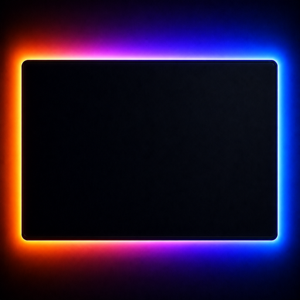

# QuikLight — нативное macOS-приложение для LED-панели Robobloq QuikLight

<p align="center">
  
</p>

Лёгкий нативный menu bar app (Rust + AppKit через `objc2`) вместо тяжёлого
официального **SyncLight** (Electron, ~430 МБ RAM, 5 процессов).

Возможности:

- **статичный цвет** (палитра macOS), яркость 0–100, выключение;
- **встроенные эффекты** панели: 2 типа × 7 эффектов (динамика и звук);
- **свой эффект «Камин»** — резко мерцающее ярко-оранжевое пламя по нижней
  части ленты, будто за монитором горит огонь (рисует само приложение, ~30 fps);
- **screen sync** — ambilight: цвета краёв экрана → LED в реальном времени
  (ScreenCaptureKit, macOS 14+, 20–60 fps, гамма/насыщенность/сглаживание);
- настройки: число LED, раскладка по краям, fps, гамма, насыщенность,
  сглаживание, световое сжатие, «выключать LED при выходе»;
- автопереподключение: при отключении/подключении панели приложение
  продолжает работать.

## Железо

| | |
|---|---|
| Устройство | Robobloq QuikLight / Feelin Light Q1 (USB) |
| VID:PID | `0x1A86:0xFE07` |
| Interface 0 | канал управления (64-байтные HID-отчёты) |

> ⚠️ У панели **два** HID-интерфейса. Interface 1 (keyboard) игнорирует
> команды цвета — приложение всегда открывает interface 0.
> Протокол верифицирован: см. `docs/PROTOCOL.md` и `docs/REFERENCES.md`.

## Сборка

Требуется только Rust (stable) и Command Line Tools (не Xcode). Скрипт
`build_app.sh` сам вызывает `cargo build`, поэтому достаточно одной команды:

```bash
./scripts/build_app.sh --release        # соберёт target/release/QuikLight.app
open target/release/QuikLight.app
```

Полезные варианты: `--debug` (debug-профиль), `--skip-sign` (без подписи),
`--sign "Имя сертификата"` (постоянная подпись — разрешение «Запись экрана»
переживает пересборки). `cargo build --release` можно запускать и отдельно,
если нужна только проверка компиляции.

## Использование

1. Подключите панель по USB (драйверы не нужны — стандартный HID).
2. Запустите приложение — в menu bar появится иконка QuikLight
   (template-иконка, macOS перекрашивает её под светлую/тёмную тему;
   при выключенной подсветке иконка полупрозрачная).
3. Меню:
   - **Подсветка** — переключатель: включить/погасить;
   - **Режимы** (выбрать можно только один):
     - **Статичный цвет** — под ним сразу кружки готовых оттенков;
     - **Screen sync** — цвет по краям экрана;
     - **Эффекты** → Динамика и Звук (встроенные) + **Камин** (свой эффект);
   - **Яркость** — слайдер прямо в меню;
   - **Настройки…** — LED, раскладка, fps, гамма, насыщенность, сглаживание,
     световое сжатие;
   - **Выйти** — погасит подсветку, если включена опция.

Для **Screen sync** нужно разрешение «Запись экрана»: Системные настройки →
Конфиденциальность и безопасность → «Запись экрана и системного звука»
(macOS 14: «Запись экрана») → включите **QuikLight**.

### Screen sync просит разрешение, хотя оно уже выдано

Причина — обычно **ad-hoc подпись**: при каждой пересборке меняется
«личность» приложения, и для macOS это «новое» приложение. Старая запись
в настройках остаётся, но к новому бинарнику не применяется.

1. Запускайте собранный бандл, а не бинарник из `target/`:
   `open target/release/QuikLight.app`. `cargo run` запускает сырой бинарник
   без бандла — для macOS это отдельное «приложение» с меняющимся
   идентификатором.
2. Удалите в настройках все старые записи QuikLight и включите текущую
   (или сбросьте: `tccutil reset ScreenCapture ru.quiklight.macos`).
3. Полностью закройте приложение (Cmd+Q) и запустите снова — разрешение
   применяется только к новому процессу.
4. **Не пересобирайте приложение после выдачи разрешения** — каждая
   пересборка вернёт запрос.

Чтобы разрешение переживало пересборки, подписывайте постоянным
сертификатом вместо ad-hoc:

- Keychain Access → Certificate Assistant → Create a Certificate: имя
  «QuikLight Dev», тип Code Signing;
- `./scripts/build_app.sh --release --sign "QuikLight Dev"`.

Быстрый вариант — скрипт (создаёт самоподписанный сертификат в связке ключей
`login`; при первом использовании macOS спросит доступ к ключу для `codesign`):

```bash
./scripts/create_dev_cert.sh "QuikLight Dev"
```

Надёжнее всего — обычный Apple Development / Developer ID сертификат.
На macOS 15+ система дополнительно периодически показывает повторное окно
подтверждения записи экрана даже для разрешённых приложений — это штатное
поведение macOS, к QuikLight оно не относится.

## Обновление приложения

Меню → **Проверить обновление…**: приложение читает манифест `latest.json` из
последнего GitHub-релиза, сравнивает версии и, если доступна более новая,
предлагает скачать и установить её.

- Работает только при запуске из `QuikLight.app` (не через `cargo run`).
- Архив качается в `~/Library/Caches/ru.quiklight.macos/`, сверяется с SHA-256
  из манифеста и проверяется `codesign`, затем распаковывается.
- Бандл подменяется после выхода приложения; при ошибке восстанавливается
  прежняя версия, лог — `~/Library/Logs/QuikLight/update.log`.
- Разрешение «Запись экрана» переживает обновление, только если оба релиза
  подписаны одним сертификатом (см. ниже). Если подпись другая, приложение
  откажется устанавливать обновление и объяснит причину.

Релиз публикуется скриптом (нужны GitHub CLI и сертификат):

```bash
./scripts/release.sh --sign "QuikLight Dev" [--notes notes.md] [--draft]
```

Скрипт собирает и подписывает `.app`, пакует `QuikLight-<версия>.zip`, считает
SHA-256, генерирует `latest.json` и создаёт GitHub Release с тегом
`v<версия>`. Версия берётся из `Cargo.toml`.

## CLI-проверка железа (hidprobe)

```bash
cargo run -p hidprobe -- info          # UUID/device_id, число LED, прошивка
cargo run -p hidprobe -- color 255 0 0 # вся лента красным
cargo run -p hidprobe -- brightness 50
cargo run -p hidprobe -- off
cargo run -p hidprobe -- effect 2 0    # динамический эффект 0
cargo run -p hidprobe -- speed 30      # скорость эффектов (инвертируется)
cargo run -p hidprobe -- help          # справка по командам
```

## Проверка SC-каналов (screen sync) на железе

```bash
cargo run -p quiklight-core --example sync_probe
```

Показывает на ленте два градиента (многочанковые SC-кадры: 51 LED × 3 байта =
153 байта payload → 3 HID-отчёта), затем гасит. Полезно, если screen sync
в приложении не работает, а статичный цвет — работает.

## Разработка

```bash
cargo fmt --all                         # форматирование
cargo clippy --workspace --all-targets  # линтер (должен быть чист)
cargo test --workspace                  # юнит-тесты
cargo test -p quiklight-core packet::   # один модуль (фильтр по имени)
```

Юнит-тесты лежат inline (`#[cfg(test)] mod tests`) рядом с кодом и не требуют
железа: протокол (checksum, чанкинг, эталонные hex-пакеты, парсер
`readDeviceInfo` — включая реальный ответ панели), screen sync (маппинг
краёв, постобработка) и эффект «Камин» можно проверять без подключённой панели.

## Структура

```
crates/
├── quiklight-core/   # протокол RB/SC, HID-транспорт, захват экрана, цвет
├── quiklight-app/    # menu bar приложение (AppKit через objc2)
└── hidprobe/         # CLI-проверка железа (фаза 0)
assets/icons/         # иконки приложения и menu bar
scripts/build_app.sh  # сборка .app-бандла (+ подпись)
docs/                 # документация проекта
```

Подробная карта модулей, поток данных UI ↔ engine и точки расширения —
в [`docs/ARCHITECTURE.md`](docs/ARCHITECTURE.md).

## Документация

| Документ | Содержание |
|---|---|
| [`docs/PROTOCOL.md`](docs/PROTOCOL.md) | Протокол устройства: кадры, action-коды, hex-векторы, подводные камни |
| [`docs/ARCHITECTURE.md`](docs/ARCHITECTURE.md) | Крейты, модули, потоки, как расширять |
| [`docs/DECISIONS.md`](docs/DECISIONS.md) | Журнал архитектурных решений и открытые вопросы |
| [`docs/REFERENCES.md`](docs/REFERENCES.md) | Внешние open-source реализации |
| [`AGENTS.md`](AGENTS.md) | Команды и инварианты для AI-агентов |
| [`docs/ICON_TZ.md`](docs/ICON_TZ.md) | ТЗ на иконки (архив, выполнено) |

## Ограничения

- **Screen sync требует macOS 14+** (используется `SCScreenshotManager`);
  статичные режимы и эффекты работают на macOS 13+.
- BLE/донгл-вариант панели не поддерживается (другой протокол).
- **Настройки и выбранный режим не сохраняются** между запусками: файла настроек
  нет, `Settings` (`Copy`) живёт в памяти процесса и сбрасывается при выходе
  (персистентность в планах, см. `docs/DECISIONS.md`).
- Автозапуск при входе в систему пока не реализован.
- Обновления проверяются только вручную (пункт меню) и ставятся только при
  запуске из `.app`; репозиторий с релизами должен быть публичным.
